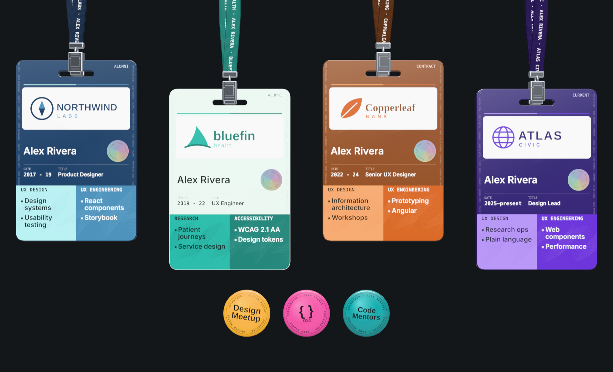

# Lanyard Portfolio

Note from Gabriel: This readme is generated by Claude Code to help you use the lanyard pattern, if you want. It's long and verbose, but covers all the little ins and outs I included to make it easy to customize. If you find an issue and want to patch it, feel free to submit a PR.

Hanging ID badges on lanyards, for a portfolio or about page. Each badge is a job: drag it and it swings on a simulated strap, tap it and it flips over to show what you did there. It's one web component, `<lanyard-wall>`, and your work history goes in as plain HTML.



It works without a mouse. Every badge has a real button over it that follows it as it swings, so keyboard and screen reader users can reach, flip and hear each one. It honors reduced motion, and without WebGL it shows the same content as a plain list.

- **Live demo:** [gabrielmtn.github.io/lanyard-portfolio](https://gabrielmtn.github.io/lanyard-portfolio/). Below the badges is their markup, and you can edit it in place.
- **No build step.** One JavaScript file plus [three.js](https://threejs.org), loaded from a CDN or installed with npm.
- **MIT licensed.** Use it on your own site, change it, ship it.

## Contents

- [Set it up on your site](#set-it-up-on-your-site)
- [Try the demo](#try-the-demo)
- [Title panel](#title-panel-lanyard-hero)
- [Badges](#badges-lanyard-badge)
- [Pins](#pins-lanyard-pin)
- [Printed labels](#printed-labels)
- [JSON instead of markup](#json-instead-of-markup)
- [Wall attributes, properties and events](#wall-attributes)
- [Your own header, and room below](#your-own-header-and-room-below)
- [Styling](#styling)
- [Accessibility](#accessibility)
- [How it works](#how-it-works)

## Set it up on your site

This works on any static site: plain HTML, GitHub Pages, Netlify, or a page in a framework. Five steps.

### 1. Get the file

Copy `src/lanyard-wall.js` from this repository into your site, for example as `js/lanyard-wall.js`. That one file is the whole component.

Using a bundler (Vite, webpack, Astro and so on)? Install it and three.js instead, then skip step 2:

```sh
npm install three github:Gabrielmtn/lanyard-portfolio
```

```js
import 'lanyard-portfolio';
```

### 2. Load three.js and the component

three.js draws the badges. Without a bundler, add an import map so the component can find it, then load the component as a module. Put this in your page's `<head>`:

```html
<script type="importmap">
{ "imports": {
  "three": "https://cdn.jsdelivr.net/npm/three@0.170.0/build/three.module.js",
  "three/addons/": "https://cdn.jsdelivr.net/npm/three@0.170.0/examples/jsm/"
} }
</script>
<script type="module" src="js/lanyard-wall.js"></script>
```

Any three.js from 0.160 on works.

### 3. Load your fonts (optional)

The card faces are drawn to a canvas, so they use whatever fonts the page has loaded. The demo uses Anybody, Instrument Sans and IBM Plex Mono from Google Fonts:

```html
<link rel="stylesheet" href="https://fonts.googleapis.com/css2?family=Anybody:wdth,wght@50..150,400..900&family=IBM+Plex+Mono:wght@400;500;600&family=Instrument+Sans:wght@400;500;600&display=swap">
```

Use your own by setting the [font custom properties](#styling). The component waits up to 2.5 seconds for fonts before it draws.

### 4. Write your badges

Add the wall where you want it, with one `<lanyard-badge>` per job. Your name and contact line go on the wall; everything about a job goes on its badge. An optional `<lanyard-hero>` puts a title panel at the top, with the lanyards hanging behind it.

```html
<lanyard-wall name="Alex Rivera" contact="If found, email: alex@example.com">

  <lanyard-hero eyebrow="Product designer / UX engineer" heading="Alex Rivera" email="alex@example.com"
                links="See my work /work | Case studies /case-studies"
                text="I design and build accessible products, from research to the components that ship."></lanyard-hero>

  <lanyard-badge org="Northwind Labs" role="Product Designer" start="03/2017" end="08/2019"
                 logo="img/northwind.svg"
                 color="#1d3557" band="#a8dadc" band2="#457b9d" strap="#14243b">
    <lanyard-section label="UX design">
      <ul data-side="front"><li>Design systems</li><li>Usability testing</li></ul>
      <ul data-side="back"><li>Built the first shared design system for three product teams</li></ul>
    </lanyard-section>
    <lanyard-section label="UX engineering">
      <ul data-side="front"><li>React components</li></ul>
      <ul data-side="back"><li>Shipped 40 accessible React components with docs</li></ul>
    </lanyard-section>
  </lanyard-badge>

  <!-- more badges, oldest first -->

  <lanyard-pin name="Design Meetup" text="Design|Meetup" color="#ffb31a" note="Organizer · 2018"></lanyard-pin>
</lanyard-wall>
```

- Badges hang left to right in the order you write them.
- Leave out `end` on your current job and it reads "present".
- The front of a badge shows short items (up to 4 per section); the back takes full sentences.
- Pins are optional round buttons for talks, volunteering or communities.

The full list of attributes is under [Badges](#badges-lanyard-badge).

### 5. Serve it and check

Modules and import maps need a web server, not a file opened from disk. From your site's folder, run any static server:

```sh
npx serve        # or: python3 -m http.server
```

Then open the address it prints. On GitHub Pages or any host, it just works once pushed.

### Optional: fade it in, and show something before it loads

The element gets a `ready` attribute once the badges are drawn, which you can use to fade it in. Its badge markup is ordinary HTML, so you can also style it as a plain list for the moment before the script loads, or for visitors without JavaScript:

```css
lanyard-wall { opacity: 0; transition: opacity 0.8s ease; }
lanyard-wall[ready], lanyard-wall.no-gl { opacity: 1; }

lanyard-wall:not(:defined) lanyard-badge { display: block; margin-bottom: 1rem; }
lanyard-wall:not(:defined) lanyard-badge::before { content: attr(org) " · " attr(role); display: block; font-weight: 600; }
lanyard-wall:not(:defined) lanyard-section::before { content: attr(label); display: block; }
lanyard-wall:not(:defined) lanyard-pin { display: none; }
```

### Troubleshooting

| What you see | Likely cause |
| --- | --- |
| Nothing renders, and the console says `Failed to resolve module specifier "three"` | The import map is missing, or comes after the component's `<script>`. It must come first. |
| Nothing renders, and the page was opened as `file://` | Serve it over HTTP (step 5). |
| A logo doesn't show | The path is wrong, or the image is on another site without CORS. An SVG needs `width` and `height` attributes. |
| Cards use a fallback font | The fonts weren't loaded within 2.5 seconds. Preload them, or set the font custom properties. |
| A plain list instead of badges | The browser has no WebGL. That's the built-in fallback. |

## Try the demo

The demo is live at [gabrielmtn.github.io/lanyard-portfolio](https://gabrielmtn.github.io/lanyard-portfolio/), served by GitHub Pages straight from `index.html` on `main`. To run it yourself, clone the repository and serve it:

```sh
git clone https://github.com/Gabrielmtn/lanyard-portfolio.git
cd lanyard-portfolio
npx serve
```

`index.html` shows four made-up badges and three pins. Below them is the wall's own markup, and every value in it is editable: change an attribute or a list item and that badge redraws in place while it keeps swinging. Click a color swatch for a picker. Faded attributes are ones a badge isn't using; type into one to turn it on. The Reduce motion button in the corner shows the calmer version.

## Title panel: `<lanyard-hero>`

A panel at the top of the wall for your name and a short introduction, with buttons and your email. The lanyards hang from the very top of the element, behind it, so it reads as the page's hero. Everything in the panel is real, selectable text and real links.

```html
<lanyard-hero eyebrow="UX Architect / Designer / Engineer" heading="Gabriel Martin" email="you@example.com"
              links="See my work portfolio/ | Case studies case-studies/"
              text="A sentence or two about what you do."></lanyard-hero>
```

| Attribute | What it does |
| --- | --- |
| `eyebrow` | Small uppercase label over the title |
| `heading` | The title, as an `<h1>`. Set `heading-level="2"` for an `<h2>` |
| `text` | The body text |
| `links` | Buttons, as `Label url` pairs separated by `\|`. The url is the last word, and the first button is filled |
| `email` | Shown as a `mailto:` link after the buttons |

For more than one paragraph, or links that open in a new tab, write them as children instead: `<p>` elements become the body and `<a href>` elements become the buttons.

```html
<lanyard-hero eyebrow="Design engineer" heading="Alex Rivera" email="alex@example.com">
  <p>First paragraph.</p>
  <p>Second paragraph.</p>
  <a href="/work">See my work</a>
  <a href="https://github.com/alex" target="_blank">GitHub</a>
</lanyard-hero>
```

Its colors come from `--lanyard-accent` (filled button), `--lanyard-accent-ink` (text on it), `--lanyard-ink` and `--lanyard-muted`; `--lanyard-hero-bg` sets the panel, `--lanyard-hero-max` the width it lines up with (default 1180px) and `--lanyard-hero-pad` the space around it. Restyle anything else with `::part(hero-panel)`, `::part(hero-title)`, `::part(hero-text)` and so on.

## Badges: `<lanyard-badge>`

Only `org` is required; everything else has a default.

| Attribute | Example | What it does |
| --- | --- | --- |
| `org` | `"Northwind Labs"` | Organization, set large on the front when there's no logo |
| `role` | `"Product Designer"` | Title, printed beside the dates |
| `start`, `end` | `"03/2017"`, `"08/2019"` | Dates as `MM/YYYY`. Leave out `end` for "present" |
| `logo` | `"img/northwind.svg"` | Logo on a white plate across the top, in place of the org name. A wide wordmark around 3 : 1 fits best; an SVG needs a `width` and `height` |
| `sub` | `"Digital banking"` | A line under the logo |
| `sub-logo` | | A second, smaller logo under the first |
| `color` | `"#1d3557"` | Card color. Text color is picked for contrast automatically |
| `band`, `band2` | `"#a8dadc"`, `"#457b9d"` | Colors of the two halves of the bottom band |
| `strap`, `strap-ink` | `"#14243b"` | Strap color, and an optional color for its print |
| `display-name` | | What screen readers call the org, if it differs from `org` |
| `front-image`, `back-image` | | Replace a whole face with your own image (1024 × 1536) |
| `id` | `"northwind"` | Returned in events |

Colors are hex values (`#1d3557` or `#1d5`).

### Sections

A badge has up to two `<lanyard-section>` elements, shown side by side on the front and stacked on the back. `label` is the heading. Inside, `<ul data-side="front">` holds short items for the front (up to 4) and `<ul data-side="back">` holds sentences for the back. Without `data-side`, the first list is the front and the second the back.

### Live updates

Change any of this markup with JavaScript (an attribute, a heading, a list item) and the affected cards redraw in place. The badges keep swinging, and a flipped badge stays flipped. Adding or removing a badge or a pin rebuilds the wall.

## Pins: `<lanyard-pin>`

```html
<lanyard-pin name="Open Source" text="{ }" small="OSS" ring="Open Source · Contributor" color="#e8459b" note="Contributor"></lanyard-pin>
```

`text` is the large text, with `|` between lines. `ring` runs around the rim (default: the name), `small` sits under the large text, and `note` shows in the tooltip.

## Printed labels

Every piece of fixed text on a card or strap can be changed. Set it on `<lanyard-wall>` to change it for every badge, or on one `<lanyard-badge>` to override it there.

| Attribute | Default | Where it prints |
| --- | --- | --- |
| `name` | none | Your name, on the front and the strap |
| `tag` | `Alumni` | Top corner of the front. `tag=""` hides it |
| `date-label`, `title-label` | `Date`, `Title` | Small labels over the dates and the role |
| `strap-text` | name · org | Repeated along the strap |
| `contact` | none | Bottom of the back, such as `If found, email: you@example.com` |
| `seal` | `Lanyard Portfolio · Alumni` | Around the holographic seal |
| `empty-heading`, `empty-text` | `On the job`, `Nothing listed yet.` | The back, when a badge has no details |

On the wall, `labels="UX design | UX engineering"` sets the default section headings for badges whose sections have no `label`.

## JSON instead of markup

You can put the same data in a `<script type="application/json">` inside the wall, or set it from JavaScript. Badges use the attribute names in camelCase (`strapText`, `dateLabel`), with sections as `{ "label", "front": [], "back": [] }`:

```json
{ "badges": [ { "org": "Beta Co", "role": "Engineer", "start": "02/2022", "color": "#7a3b12", "tag": "Contract",
    "sections": [ { "label": "Systems", "front": ["Tokens"], "back": ["Set up design tokens"] },
                  { "label": "Code", "front": ["Lit"], "back": ["Built the components in Lit"] } ] } ],
  "pins": [ { "name": "Meetup", "big": ["Meet", "up"], "color": "#ffb31a" } ] }
```

If both are present, the `badges` and `pins` properties win, then the markup, then the JSON.

## Wall attributes

| Attribute | What it does |
| --- | --- |
| `label` | Accessible name for the group of badges (default `Work history badges`) |
| `hint` | The hint in the corner. Set `hint=""` to hide it |
| `reduced-motion` | Forces reduced motion. It's also on automatically when the visitor's system asks for it. `reduced-motion="off"` forces full motion, for a page with its own motion switch |
| `debug` | Shows the physics: rope nodes, constraints and frame timing |

Plus the [printed-label](#printed-labels) defaults.

### Properties and methods

```js
const wall = document.querySelector('lanyard-wall');
wall.badges = [...];          // takes precedence over the markup and JSON
wall.pins = [...];
wall.labels = ['Design', 'Engineering'];   // default section headings
wall.flip(0);                 // flip the first badge
wall.flipAll();               // flip every badge to its back, or all back to the front
wall.nudge(2, -1);            // push the third badge to the left
wall.reducedMotion = true;
```

### Events

| Event | `detail` |
| --- | --- |
| `lanyard-ready` | Fired once the badges are drawn. The element also gets a `ready` attribute |
| `lanyard-flip` | `{ index, id, side }`, where `side` is `"front"` or `"back"` |
| `lanyard-unwind` | `{ index, id }`, when a strap wound 7 half-twists lets go |

## Your own header, and room below

**A header of your own.** Anything with `slot="header"` inside the wall is placed at its top, like the title panel, with the lanyards hanging behind it. Use it when `<lanyard-hero>` doesn't fit your design. Your header's empty space lets drags through to the badges only if you set `pointer-events: none` on it and `auto` on the parts people click.

```html
<lanyard-wall>
  <header slot="header" class="my-header">…</header>
  <lanyard-badge …></lanyard-badge>
</lanyard-wall>
```

**A line in the corner.** Anything with `slot="corner"` sits in the bottom-right corner of the badge area, in small type: a credit, or a link.

```html
<a slot="corner" href="https://github.com/Gabrielmtn/lanyard-portfolio">Made with Lanyard Portfolio</a>
```

Style it from outside with `::part(corner)`. On narrow screens it shares the bottom edge with the hint, so either hide the hint (`hint=""`) or move one of them up.

**Room below the badges.** Set `--lanyard-overhang` and the element reaches that far below the badges. Pull the next section of your page up over it with a negative margin and a `z-index` of 3, and a badge dragged or swung low slides behind that section, while a second canvas draws it over the top. Without it, a badge dragged below the wall is simply cut off at the edge.

```css
lanyard-wall { --lanyard-overhang: 560px; }
lanyard-wall + main { position: relative; z-index: 3; margin-top: -560px; }
```

For this to work the wall must not be its own stacking context, so don't give `<lanyard-wall>` an `opacity` below 1, a `transform`, a `filter` or a `z-index`.

## Styling

The element sizes its own height to fit the badges, and lays them out for the width it has: one row on wide screens, two staggered columns on tablets, and a single overlapping stack on phones. Fonts and colors come from custom properties:

```css
lanyard-wall {
  --lanyard-font-display: "Anybody", "Arial Black", sans-serif;
  --lanyard-font-body: "Instrument Sans", system-ui, sans-serif;
  --lanyard-font-mono: "IBM Plex Mono", ui-monospace, monospace;
  --lanyard-accent: #8ea4ff;     /* debug lines */
  --lanyard-focus: #ffd166;      /* keyboard focus ring */
  --lanyard-shadow: 0.5;         /* shadow strength on the wall, 0 to 1 */
}
```

The background is transparent, so the badges hang on whatever is behind the element. Parts you can style from outside: `canvas`, `overlay`, `header`, `area`, `hint`, `hud` and the `hero-*` parts above. It never scrolls or adds a scrollbar, even when a badge is dragged off the side.

## Accessibility

- The canvas is hidden from assistive technology. A real `<button>` sits over each badge and pin and moves with it.
- Enter or Space flips a badge, and the side now showing is announced once the flipping stops. Arrow Left and Right give it a push.
- Each badge button is described by the full text of both sides.
- Reduced motion turns flips into a turn in place, removes the swing on release, and stops the breeze.
- Without WebGL, the element renders the same content as a list of cards.

## How it works

Each strap is a chain of 8 Verlet nodes and each card is a rigid body, solved together with XPBD at 480 substeps per second. Card faces, straps and pins are drawn to canvas and used as textures. Badges that overlap hang in separate layers, front to back, and each one keeps its layer even while you hold it, so a strap never jumps in front of the badges ahead of it. A badge in your hand moves the ones it touches at your hand's speed, without flinging them.

Every flip winds one more half-twist into the strap, always the same way, so fast clicks stack up and spin it faster instead of undoing each other. Each twist hitches the badge up a little. Wind 7 half-twists into a strap and it lets go: it unspins like a torsion spring, leaning outward as it whips round (the heavy clip end feels the largest pull), and settles front side out.

## Browser support

Current Chrome, Edge, Firefox and Safari. It needs WebGL for the badges, and falls back to a list without it.

## License

[MIT](LICENSE) © 2026 Gabriel Martin
